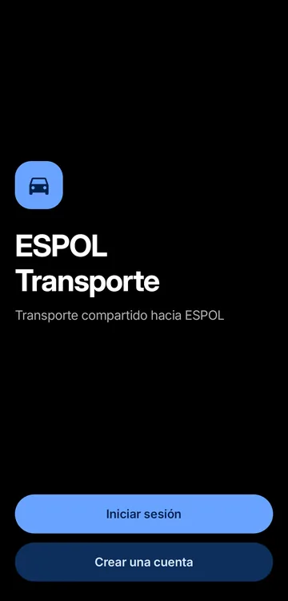
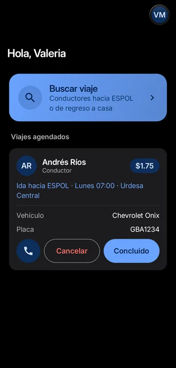
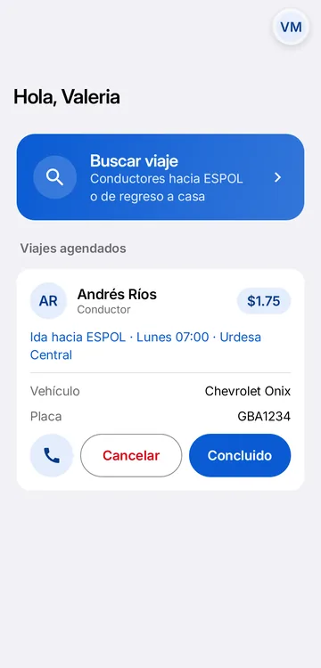
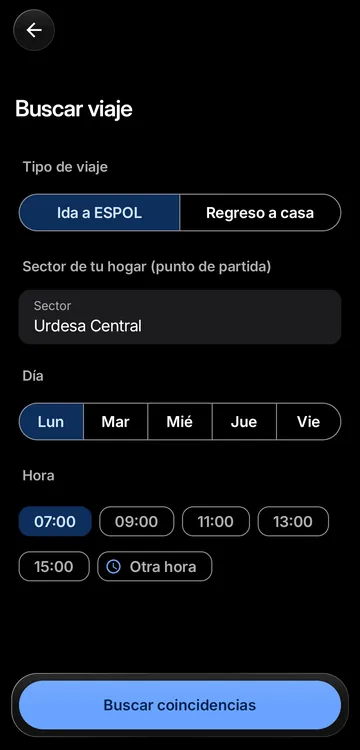
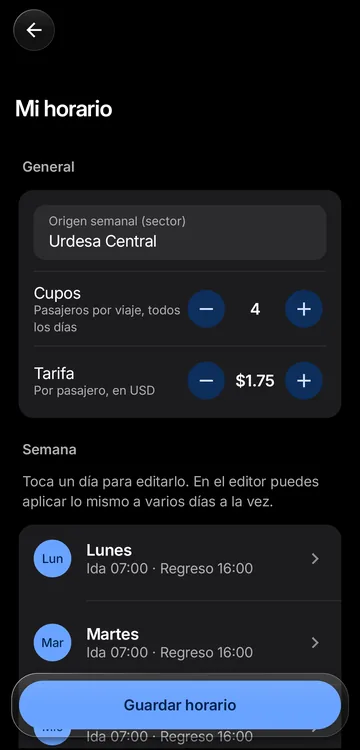
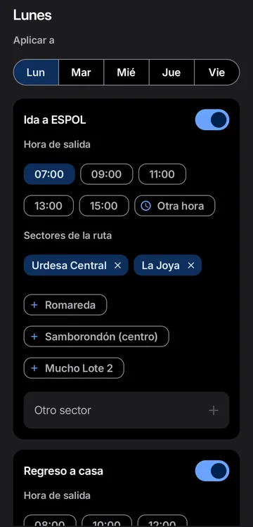

# ESPOL Transport — App Android

Aplicación Android nativa (Kotlin + Jetpack Compose) de un sistema de **carpooling para estudiantes de la ESPOL** (Guayaquil, Ecuador). Conecta a estudiantes que necesitan llegar al campus o volver a casa con conductores que ya hacen ese recorrido, según sector, día y hora.

Es el cliente móvil del backend [`espol-transport-api`](https://github.com/SagazArias/espol-transport-api) (FastAPI).

**Versión actual: 0.2.1** · [Descargar APK](https://github.com/SagazArias/espol-transport-android/releases/latest) (Android 8.0+)

[](https://github.com/SagazArias/espol-transport-android/actions/workflows/ci.yml)

| Bienvenida | Bandeja (pasajero) | Modo claro | Buscar viaje |
|---|---|---|---|
|  |  |  |  |

| Resultados | Horario del conductor | Editor de un día |
|---|---|---|
|  |  |  |

*Capturas en un teléfono real (Android 16) con cuentas de demostración; los nombres, la placa y el vehículo son ficticios.*

---

## Problema que resuelve

Muchos estudiantes recorren a diario las mismas rutas hacia el campus Gustavo Galindo, cada uno por su cuenta. La app permite que:

- un **conductor** publique su horario semanal de ida y regreso, la ruta (sectores), sus cupos y la tarifa;
- un **pasajero** busque conductores compatibles con su sector, día y hora, y reserve un cupo;
- ambos gestionen sus viajes (completar, cancelar con motivo, calificar) desde una bandeja común.

---

## Funcionalidades

### Autenticación y cuenta

| Función | Detalle |
|---|---|
| Registro de pasajero | Con correo institucional `@espol.edu.ec` |
| Registro de conductor | Incluye datos de contacto y del vehículo (placa, marca, modelo) |
| Inicio de sesión por rol | El usuario elige primero si entra como pasajero o conductor |
| "Mantener sesión iniciada" | Si se marca, la app reabre sin pedir credenciales |
| Recuperación de contraseña | Mediante una **frase de recuperación** definida en el registro: se verifica y luego se establece una nueva contraseña |
| Cerrar sesión | Borra el token local |
| Eliminar cuenta | Diálogo de confirmación que exige la contraseña |

### Pasajero

- Buscar viaje: tipo (**ida** hacia ESPOL o **regreso** a casa), sector de origen/destino (se escribe o se toca uno de los sectores sugeridos), día (lunes a viernes) y hora (horas predefinidas por la API u "otra hora" con selector de reloj).
- Ver conductores coincidentes con: nombre, vehículo, ruta coincidente, cupos disponibles, tarifa y **calificación promedio**; botón para llamar al conductor.
- Reservar un cupo.

### Conductor

- Configurar el **horario semanal**: sector de origen, cupos (aplican a toda la semana) y tarifa (valores permitidos por la API, entre $1.00 y $2.50). Cupos y tarifa se cambian con botones − / +.
- La semana se ve como una lista de lunes a viernes con un resumen por día ("Ida 09:00 · Regreso 17:00"). Al tocar un día se abre un editor con:
  - **Aplicar a**: copiar la misma configuración a varios días a la vez.
  - Ida y regreso que se activan o desactivan, hora de salida (sugeridas u "otra hora" con reloj) y los **sectores de la ruta**, elegidos tocando el catálogo de sectores de la API o escribiendo uno nuevo.
- Guardar / actualizar el horario. Un día marcado "Sin viajes" se borra en el servidor.

### Bandeja (ambos roles)

- Lista de viajes reservados y avisos (por ejemplo, reservas nuevas o cancelaciones).
- Desde cada viaje: **llamar** a la otra parte, **cancelar** indicando el motivo (lo recibe la otra parte) o marcarlo como **concluido**; como pasajero, luego se **califica al conductor** de 1 a 5 estrellas.
- Menú de cuenta (avatar) para cerrar sesión o eliminar la cuenta.

### Diseño

- Estética inspirada en Apple sobre Material 3: títulos grandes que se contraen al hacer scroll, fondos agrupados y tarjetas, en **modo claro y oscuro** según el sistema.
- Tipografía **Inter** (cortes de texto y de títulos) incluida en la app.
- **Liquid glass claro** (sin desenfoque) en el botón atrás, el menú de cuenta y las barras flotantes de acción.

---

## Stack tecnológico

| Área | Tecnología | Versión |
|---|---|---|
| Lenguaje | Kotlin (JVM target 17) | 1.9.25 |
| Build | Android Gradle Plugin / Gradle | 8.13.2 / 8.13 |
| SDK | `minSdk` 26, `targetSdk` y `compileSdk` 35 | — |
| UI | Jetpack Compose (BOM) + Material 3 + Material Icons Extended | BOM 2024.10.01, compilador 1.5.15 |
| Navegación | Navigation Compose | 2.8.4 |
| Estado | Lifecycle ViewModel Compose / Runtime Compose | 2.8.7 |
| Red | Retrofit + Gson converter | 2.11.0 |
| HTTP | OkHttp logging-interceptor | 4.12.0 |
| Persistencia | DataStore Preferences | 1.1.1 |
| Concurrencia | Kotlin Coroutines | 1.9.0 |

---

## Arquitectura

Arquitectura **MVVM** en capas, con una sola Activity y toda la UI en Compose.

```
UI (Composables)  ──>  ViewModels  ──>  ApiService (Retrofit)  ──>  espol-transport-api
                           │
                           └──>  TokenStore (DataStore)
```

- **`MainActivity`** monta el tema y `AppNav`.
- **`AppContainer`**: inyección de dependencias manual; crea `TokenStore` y `ApiService` una sola vez y los pasa a las factories de los ViewModels.
- **ViewModels**
  - `AuthViewModel`: registro, login, recuperación de contraseña, sesión persistida, logout y eliminación de cuenta.
  - `TransportViewModel`: horarios y tarifas, búsqueda de coincidencias, reservas, bandeja, completar/cancelar/calificar y horario del conductor.
- **Navegación** (`navigation/AppNav.kt`): un `NavHost` con rutas `bootstrap` → `welcome` → selección de rol → `login` / registro / recuperación → `role_gate`, que consulta `GET auth/me` y lleva a la bandeja del pasajero o del conductor; desde ahí se accede a búsqueda/resultados o al horario. Si `auth/me` falla por red (por ejemplo, la API despertando), se ofrece reintentar sin perder la sesión; solo un 401/403 la cierra. Las pantallas de autenticación están en `ui/auth/`.
- **Capa de datos**
  - `ApiService`: interfaz Retrofit con funciones `suspend` (rutas `auth/*`, `trip-times`, `zones` y `zones/resolve`, `driver/weekly-schedule`, `matches/search`, `bookings/*`).
  - `ApiProvider`: configura Gson con `snake_case` (`LOWER_CASE_WITH_UNDERSCORES`), timeouts de 30 s, un `AuthInterceptor` que añade `Authorization: Bearer <token>` y logging nivel `BASIC`.
  - `TokenStore`: guarda el token JWT y la preferencia "mantener sesión" en DataStore (`auth_session`). Al arrancar, la pantalla `bootstrap` decide si hay auto-login.
- **Errores**: `HttpErrors.kt` convierte excepciones y el campo `detail` de FastAPI en mensajes legibles en español (incluidos los errores de conexión y de tiempo de espera).

---

## Decisiones técnicas

- **URL de la API en tiempo de build**: `app/build.gradle.kts` lee `api.base.url` de `local.properties`, le agrega la `/` final si falta y la expone como `BuildConfig.API_BASE_URL`. Por defecto usa la API desplegada en Render, `https://espol-transport.onrender.com/`. Así no hay URLs ni IPs en el código fuente.
- **Validación en el cliente, igual que en el servidor**:
  - Contraseña (`PasswordPolicy.kt`): 8 a 128 caracteres, con mayúscula, minúscula, número y símbolo, sin espacios.
  - Frase de recuperación (`RecoveryPhrasePolicy.kt`): 4 a 64 caracteres sin espacios; es distinta de la contraseña.
- **Tráfico HTTP sin cifrar**: `network_security_config.xml` y `usesCleartextTraffic` permiten `http://`, necesario para probar contra la API en la red local. Para producción hay que servir la API por HTTPS y restringir esto (ver mejoras).
- **Token en DataStore** en lugar de SharedPreferences, con acceso asíncrono por corrutinas.
- **DI manual** con `AppContainer`, suficiente para el tamaño del proyecto sin agregar Hilt.

---

## Requisitos

- Android Studio reciente (compatible con AGP 8.13) y JDK 17.
- Android SDK 35.
- Emulador o dispositivo con Android 8.0 (API 26) o superior.
- Conexión a internet: por defecto la app usa la API desplegada en `https://espol-transport.onrender.com/`. Para desarrollo, también puedes levantar el backend [`espol-transport-api`](https://github.com/SagazArias/espol-transport-api) en tu PC.

## Cómo ejecutarlo

1. **Clonar el repositorio**

   ```bash
   git clone https://github.com/SagazArias/espol-transport-android.git
   cd espol-transport-android
   ```

2. **URL de la API (opcional)**: sin configurar nada, la app usa la API desplegada en `https://espol-transport.onrender.com/`. El plan gratuito de Render se duerme cuando no se usa, así que la primera petición puede tardar 30–60 s. Para usar un backend local, copia `local.properties.example` a `local.properties` (o agrega la línea a tu `local.properties`, que Android Studio genera con `sdk.dir`):

   ```properties
   # Teléfono físico en la misma red Wi-Fi: IPv4 del PC (ipconfig / ifconfig)
   api.base.url=http://192.168.x.x:8000/

   # Emulador
   api.base.url=http://10.0.2.2:8000/
   ```

3. **Solo con backend local: levántalo** en el PC, escuchando en todas las interfaces para que el teléfono lo alcance (ver el README de la API), por ejemplo:

   ```bash
   uvicorn app.main:app --host 0.0.0.0 --port 8000
   ```

4. **Compilar y ejecutar**: abre el proyecto en Android Studio y pulsa *Run*, o desde la terminal:

   ```bash
   ./gradlew installDebug        # Windows: gradlew.bat installDebug
   ```

5. **Generar APK**

   ```bash
   ./gradlew assembleDebug       # app/build/outputs/apk/debug/app-debug.apk
   ./gradlew assembleRelease     # app/build/outputs/apk/release/app-release.apk
   ```

   Para firmar el release, crea `keystore.properties` en la raíz (está en `.gitignore`, igual que los `.jks`):

   ```properties
   storeFile=mi-clave.jks
   storePassword=...
   keyAlias=...
   keyPassword=...
   ```

   Sin ese archivo, `assembleRelease` genera un APK sin firmar.

   Los APK publicados están en [Releases](https://github.com/SagazArias/espol-transport-android/releases). La versión se define en `app/build.gradle.kts` (`versionName` / `versionCode`).

> Si cambias `api.base.url`, vuelve a compilar: el valor queda fijado en `BuildConfig`.

### Pruebas

```bash
./gradlew testDebugUnitTest
```

Las pruebas unitarias (`app/src/test/`) cubren la lógica sin UI: políticas de contraseña y de frase de recuperación, formato de horas y tarifas, el resumen de cada día del horario y los mensajes de error, incluido el caso de la API que despierta en Render. El CI de GitHub Actions las corre y compila el APK en cada push y en cada PR.

---

## Estructura del proyecto

```
app/src/main/
├── AndroidManifest.xml
├── res/
│   ├── values/ (strings, themes)
│   ├── values-night/, values-v27/   # colores de ventana y barras del sistema
│   ├── font/                        # Inter (OFL)
│   ├── drawable/ (ícono)
│   └── xml/network_security_config.xml
└── java/com/espol/transport/
    ├── MainActivity.kt
    ├── AppContainer.kt              # DI manual
    ├── navigation/AppNav.kt         # NavHost, arranque y role_gate
    ├── data/
    │   ├── api/                     # ApiService, ApiProvider (Retrofit/OkHttp)
    │   ├── local/TokenStore.kt      # DataStore
    │   └── model/                   # DTOs de auth y transporte
    └── ui/
        ├── viewmodel/               # AuthViewModel, TransportViewModel
        ├── auth/                    # bienvenida, login, registro, recuperación
        ├── passenger/               # búsqueda y resultados
        ├── driver/                  # horario semanal y editor por día
        ├── inbox/                   # bandeja, cancelar, completar, calificar
        ├── components/              # AppScreen, botones, campos, tarjetas, vidrio (Glass.kt)
        ├── theme/                   # colores claro/oscuro, tipografía Inter, formas
        └── util/                    # políticas de contraseña/frase, errores HTTP
```

---

## Mejoras futuras

- Servir la API por HTTPS y quitar el permiso global de tráfico en claro (o limitarlo a un build de debug).
- Cifrar el token en reposo (por ejemplo con Android Keystore) y manejar expiración/renovación.
- Activar R8/minificación en release.
- Pruebas de ViewModels con una API falsa y pruebas de UI con Compose.
- Notificaciones push para nuevas reservas y cancelaciones.
- Mapa para elegir sectores.
- Un ícono de la app definitivo (el actual es provisional).
- Inyección de dependencias con Hilt y una capa de repositorios si el proyecto crece.

## Licencia

Distribuido bajo la licencia MIT. Copyright (c) 2026 Samuel Arias. Ver [LICENSE](LICENSE).

La fuente Inter se distribuye bajo la SIL Open Font License 1.1; ver [licenses/Inter-OFL.txt](licenses/Inter-OFL.txt).
